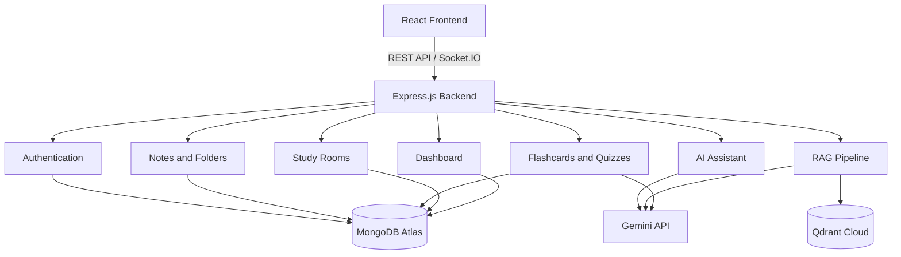
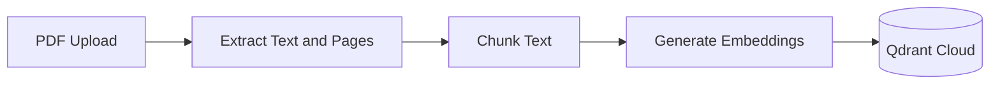
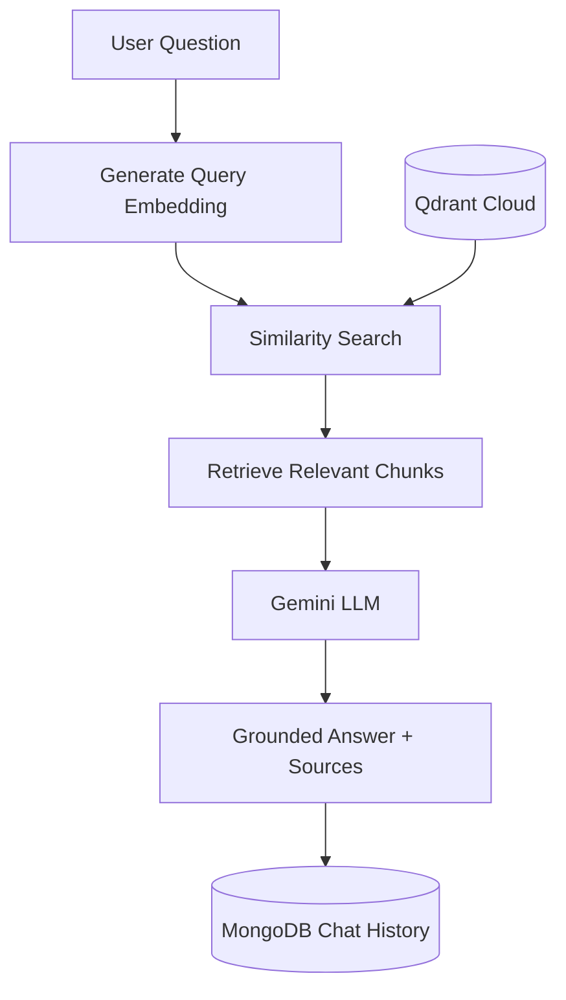

<div align="center">

# 🪺 StudyNest AI

### Learn Smarter. Remember Longer.

An AI-powered collaborative learning platform with smart notes, PDF question answering (RAG), flashcards, quizzes, and real-time study rooms.

[](https://studynest-3zx8s6boc-devayush761-7213s-projects.vercel.app/)
[](./LICENSE)


[Live Demo](https://studynest-3zx8s6boc-devayush761-7213s-projects.vercel.app/) · [Report a Bug](https://github.com/ayushkr999/StudyNest-AI/issues) · [Request a Feature](https://github.com/ayushkr999/StudyNest-AI/issues)

</div>

---

## 🔎 Overview

Students often manage notes, PDFs, revision materials, and study groups across multiple disconnected platforms.

**StudyNest AI** brings everything together into a unified learning workspace powered by Generative AI.

With StudyNest AI, users can:

- Create and organize notes with folders.
- Generate summaries, flashcards, and quizzes using AI.
- Upload PDFs and ask questions based on their content using Retrieval-Augmented Generation (RAG).
- Get context-aware answers with source page references.
- Collaborate with other students through real-time study rooms.
- Track learning progress through an interactive dashboard.

> **Note:** The backend is hosted on a free-tier service. The first request after inactivity may take 30–60 seconds while the server wakes up.

---

## ✨ Key Features

### 📝 Smart Notes

- Create, edit, search, pin, and archive notes.
- Organize notes into folders.
- Markdown editor with live preview and autosave.

### 🤖 AI Study Assistant

- Generate summaries of notes and folders.
- Explain complex concepts using the Feynman technique.
- Generate exam-oriented questions and revision notes.
- Interactive conversational study sessions.

### 📚 PDF Chat (Retrieval-Augmented Generation)

- Upload and manage PDF study materials.
- Semantic search over document chunks using Gemini embeddings and Qdrant.
- Context-aware answers with source page references.
- Question answering across multiple selected documents.
- Per-user and per-document retrieval filtering.

### 🗂️ Flashcards

- Create flashcard decks manually or generate them using AI.
- Interactive flip-card experience.
- Track mastered and pending cards.

### 🎯 AI Quiz Generator

- Generate topic-based multiple-choice quizzes.
- Choose Easy, Medium, or Hard difficulty.
- Timed attempts with automatic evaluation.
- Detailed answer explanations.
- Performance tracking and weak-topic identification.

### 👥 Collaborative Study Rooms

- Create study rooms with unique join codes.
- Real-time messaging using Socket.IO.
- Live member presence.
- Integrated AI tutor using `@ai` or `/ai` commands.

### 📊 Learning Dashboard

- Overview of notes, folders, PDFs, flashcards, and quizzes.
- Flashcard mastery and quiz performance statistics.
- Quick access to recently used learning materials.

---

## 🛠️ Tech Stack

| Layer | Technologies |
|---|---|
| Frontend | React 19, Vite, Redux Toolkit, React Router, Tailwind CSS, Axios |
| Backend | Node.js, Express.js, REST APIs |
| Database | MongoDB Atlas, Mongoose |
| Authentication | JWT, bcryptjs, HTTP-only cookies |
| Generative AI | Google Gemini API, LangChain.js |
| RAG | pdf-parse, LangChain Text Splitter, Gemini Embeddings |
| Vector Database | Qdrant Cloud |
| Real-time Communication | Socket.IO |
| Deployment | Vercel, Render |

---

## 🏗️ System Architecture

The backend follows a modular architecture where each feature is organized into its own module containing routes, controllers, and services.



---

## 🧠 How the RAG Pipeline Works

StudyNest AI implements Retrieval-Augmented Generation (RAG) to allow users to ask questions about their uploaded PDF documents.

### 1. Document Ingestion



**Process:**

1. The user uploads a PDF document.
2. Text and page information are extracted using `pdf-parse`.
3. Extracted content is divided into overlapping chunks using LangChain's text splitter.
4. Gemini generates vector embeddings for each chunk.
5. Embeddings and metadata (user ID, document ID, page number) are stored in Qdrant Cloud.

### 2. Retrieval and Answer Generation



**Process:**

1. The user's question is converted into a vector embedding.
2. Qdrant performs similarity search with user and document metadata filters.
3. The most relevant chunks are retrieved and passed to Gemini as context.
4. Gemini generates an answer grounded in the retrieved document content.
5. Answers, sources, and conversation history are stored in MongoDB.

---

## 📁 Project Structure

```text
StudyNest-AI/
│
├── backend/
│   └── src/
│       ├── config/          # Database, Gemini, Qdrant configuration
│       ├── middleware/      # Authentication, validation, rate limiting
│       ├── models/          # Mongoose schemas
│       ├── modules/
│       │   ├── auth/
│       │   ├── folders/
│       │   ├── notes/
│       │   ├── ai/
│       │   ├── rag/
│       │   ├── flashcards/
│       │   ├── quizzes/
│       │   ├── studyRooms/
│       │   └── dashboard/
│       ├── sockets/         # Socket.IO handlers
│       ├── utils/
│       ├── app.js
│       └── server.js
│
├── frontend/
│   └── src/
│       ├── app/             # Redux store
│       ├── components/
│       ├── features/        # Redux slices
│       ├── pages/
│       ├── services/        # API clients
│       ├── App.jsx
│       └── main.jsx
│
└── README.md
```

---

## ⚙️ Getting Started

### Prerequisites

- Node.js 20+
- npm 10+
- MongoDB Atlas account
- Google Gemini API key
- Qdrant Cloud account and API key

### Installation

**1. Clone the repository**

```bash
git clone https://github.com/ayushkr999/StudyNest-AI.git
cd StudyNest-AI
```

**2. Install backend dependencies**

```bash
cd backend
npm install
```

**3. Install frontend dependencies**

```bash
cd ../frontend
npm install
```

### Run Locally

Configure the environment variables before starting the application.

**Terminal 1 – Backend**

```bash
cd backend
npm run dev
```

**Terminal 2 – Frontend**

```bash
cd frontend
npm run dev
```

Open your browser and visit:

```text
http://localhost:5173
```

---

## 🔐 Environment Variables

Create a `.env` file inside the backend directory.

**backend/.env**

```env
PORT=5000
NODE_ENV=development
CLIENT_URL=http://localhost:5173

MONGO_URI=your_mongodb_connection_string
JWT_SECRET=your_jwt_secret

GEMINI_API_KEY=your_gemini_api_key

QDRANT_URL=your_qdrant_url
QDRANT_API_KEY=your_qdrant_api_key
QDRANT_COLLECTION=your_qdrant_collection
```

Create another `.env` file inside the frontend directory.

**frontend/.env**

```env
VITE_API_URL=http://localhost:5000/api
VITE_SOCKET_URL=http://localhost:5000
```

> ⚠️ Never commit `.env` files or API secrets to version control. Make sure `.env` is included in your `.gitignore`.

---

## 🔌 API Overview

| Route Prefix | Description |
|---|---|
| `/api/auth` | Registration, login, logout, session handling |
| `/api/folders` | Folder management |
| `/api/notes` | Notes CRUD, pin, archive, search |
| `/api/ai` | Summaries, explanations, AI study assistance |
| `/api/rag` | PDF upload and document question answering |
| `/api/flashcards` | Flashcard deck management and AI generation |
| `/api/quizzes` | Quiz generation, attempts, and results |
| `/api/study-rooms` | Study room creation, joining, and management |
| `/api/dashboard` | Learning statistics and progress |

---

## 🛡️ Security

- JWT authentication using HTTP-only cookies.
- Password hashing with bcryptjs.
- Protected routes through authentication middleware.
- Input validation and centralized error handling.
- API rate limiting.
- PDF upload validation.
- User-scoped vector retrieval to restrict access to individual users' documents.

---

## 🚀 Deployment

| Component | Platform |
|---|---|
| Frontend | [Vercel](https://vercel.com/) |
| Backend | [Render](https://render.com/) |
| Database | [MongoDB Atlas](https://www.mongodb.com/atlas) |
| Vector Database | [Qdrant Cloud](https://cloud.qdrant.io/) |
| AI Services | [Google Gemini API](https://aistudio.google.com/) |

### Live Application

[🚀 Open StudyNest AI](https://studynest-3zx8s6boc-devayush761-7213s-projects.vercel.app/)

---

## 🗺️ Roadmap

- [ ] Streaming AI responses.
- [ ] OCR support for scanned PDFs.
- [ ] Cloud storage for uploaded documents.
- [ ] Automated unit and integration tests.
- [ ] RAG retrieval quality evaluation.
- [ ] Enhanced collaboration features in study rooms.

---

## 🤝 Contributing

Contributions, issues, and feature requests are welcome!

1. Fork the repository.
2. Create your feature branch:

   ```bash
   git checkout -b feature/your-feature
   ```

3. Commit your changes:

   ```bash
   git commit -m "feat: add your feature"
   ```

4. Push to the branch:

   ```bash
   git push origin feature/your-feature
   ```

5. Open a Pull Request.

---

## 📄 License

Distributed under the MIT License. See the [LICENSE](./LICENSE) file for more information.

---

## 👨‍💻 Author

**Ayush Kumar**

B.Tech Information Technology  
Birsa Institute of Technology, Sindri

[](https://github.com/ayushkr999)

---

<div align="center">

⭐ If you find this project useful, consider giving it a star!

**Built with ❤️ by Ayush Kumar**

</div>
